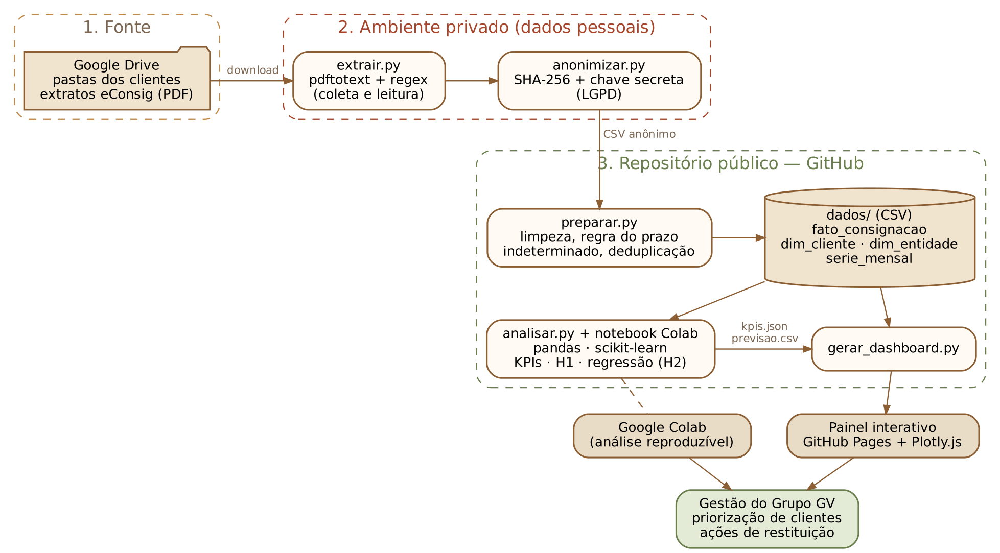

# Seguros e pecúlios no consignado de militares — Projeto de BI e Analytics

Projeto da disciplina **Projeto em Business Intelligence e Analytics** (PUCRS Online), Fase 2.
Autor: **Matheus Gandolfe** · Cliente: **Grupo GV** (assessoria jurídica e financeira de militares e pensionistas, Niterói/RJ).

| | |
|---|---|
| 📊 **Painel interativo** | https://matheusgandolfe.github.io/projeto-bi-consignado-gv/ |
| 📓 **Notebook no Google Colab** | [Abrir no Colab](https://colab.research.google.com/github/matheusgandolfe/projeto-bi-consignado-gv/blob/main/notebooks/analise_bi_consignado.ipynb) |
| 🗂️ **Dados anonimizados** | pasta [`dados/`](dados/) |

## O problema
O Grupo GV analisa os extratos de consignação (eConsig) dos clientes para encontrar **seguros e pecúlios descontados sem contratação**. Os extratos são PDFs espalhados em pastas no Google Drive e eram lidos à mão, então a empresa não tinha números confiáveis para decidir quem atender primeiro e quanto há para recuperar.

## A solução
Um pipeline em Python lê os PDFs, remove os dados pessoais, identifica os descontos de **prazo indeterminado** (critério de triagem da empresa), organiza tudo em um modelo dimensional e alimenta:
- **KPIs** e **painel interativo** (GitHub Pages + Plotly.js);
- **análise preditiva** (regressão linear) do valor descontado nos próximos 12 meses, no Google Colab.



## Resultados principais
| Indicador | Valor |
|---|---|
| Clientes analisados | 59 |
| Consignações lidas | 692 |
| Seguros/pecúlios de prazo indeterminado | 103 |
| Clientes com pelo menos um desconto | **81,4%** |
| Desconto mensal ainda ativo | **R$ 3.135,21** por mês |
| Total já pago | **R$ 165.835,89** |
| Restituição em dobro potencial (art. 42 CDC) | R$ 331.671,78 |
| Tempo médio de desconto | 36,1 meses (mediana 24) |
| Entidade com mais casos | SABEMI (58,3% dos casos) |
| Previsão de descontos nos próximos 12 meses | R$ 29.416,05 |

**Hipóteses da Fase 1**
- **H1 – leitura automática confiável (≥ 95%)**: confirmada — 100% de concordância numa amostra de 10 extratos (54 consignações). Ver [`dados/validacao_h1.csv`](dados/validacao_h1.csv).
- **H2 – previsão por regressão linear com MAPE < 15%**: não confirmada na janela completa (MAPE 22,91%), confirmada no regime atual a partir de 2022-06 (MAPE 12,64%). Ver [`dados/metricas_h2.json`](dados/metricas_h2.json).

## Estrutura do repositório
```
src/
  extrair.py            1. lê os PDFs (pdftotext + expressões regulares)       -> CSV bruto (privado)
  anonimizar.py         2. troca nome, CPF, matrícula e nº do contrato por códigos (SHA-256 + chave secreta)
  preparar.py           3. limpeza, deduplicação, regra do prazo indeterminado, modelo dimensional
  analisar.py           4. KPIs e regressão linear (H2)
  gerar_dashboard.py    5. gera o painel docs/index.html a partir dos dados
  dashboard_template.html  layout do painel (HTML + Plotly.js)
dados/                  dados ANONIMIZADOS (únicos dados publicados)
notebooks/              análise completa no Google Colab
docs/                   painel publicado no GitHub Pages + diagrama de arquitetura
```

## Como reproduzir
```bash
pip install -r requirements.txt          # e poppler-utils (pdftotext) para a etapa 1
python src/extrair.py <pasta_dos_pdfs> priv/consignacoes_bruto.csv dados/cobertura.json
SALT=<chave_secreta> python src/anonimizar.py priv/consignacoes_bruto.csv priv/consignacoes_anon.csv
python src/preparar.py priv/consignacoes_anon.csv dados
python src/analisar.py dados
python src/gerar_dashboard.py dados docs/index.html
```
As etapas 1 e 2 usam os PDFs originais e ficam fora do repositório (`.gitignore`). A partir da etapa 3 tudo roda com os dados anonimizados — inclusive o notebook no Colab.

## Cobertura e limitações
- 97 PDFs encontrados, 2 cópias idênticas descartadas, **80 lidos** (84,2%). Os 15 extratos escaneados como imagem ficaram fora (precisariam de OCR).
- 18 consignações apareciam em mais de um extrato (ativos e inativos) e foram contadas uma vez só.
- A série mensal é reconstruída a partir das parcelas pagas; a janela usada na previsão vai até 03/2025, último mês coberto por todos os extratos.
- “Potencialmente indevido” é um critério de triagem: a confirmação depende de o cliente declarar que não contratou o seguro.

## Dicionário de dados — `dados/fato_consignacao.csv`
| Coluna | Significado |
|---|---|
| cliente_id | código anônimo do cliente |
| documento_id | código anônimo do extrato de origem |
| ade | código anônimo do contrato |
| entidade_padrao | consignatária com nome padronizado |
| cod_entidade, servico | código da consignatária e serviço como aparecem no extrato |
| tipo / categoria | empréstimo/cartão ou seguro/pecúlio; categoria do seguro |
| data_inclusao | data de inclusão da consignação |
| inicio_desconto / fim_desconto | primeiro e último mês descontado (estimados a partir das parcelas pagas) |
| valor_prestacao / valor_folha | valor mensal da prestação e valor efetivamente lançado em folha (R$) |
| n_prestacoes | número de prestações ou "Indet." |
| pagas | parcelas já pagas |
| total_pago | valor_prestacao × pagas |
| situacao / data_situacao | Em Andamento, Liquidada, Deferida, Cancelada... e a data da situação |
| ativo | ainda descontando (Em Andamento) |
| prazo_indeterminado | Nº de prestações = Indet. |
| potencial_indevido | prazo indeterminado com parcelas pagas, exceto pecúlio POUPEX/FHE abaixo de R$ 8 |
| data_carga | data da carga das margens do extrato |

`dim_cliente.csv`: uma linha por cliente (consignações ativas, entidades, seguros, valores). `dim_entidade.csv`: uma linha por consignatária. `serie_mensal.csv`: valor descontado por mês.

## Ferramentas
Python 3 · pandas · NumPy · scikit-learn · Matplotlib · poppler (pdftotext) · Plotly.js · Google Colab · Git/GitHub · GitHub Pages
